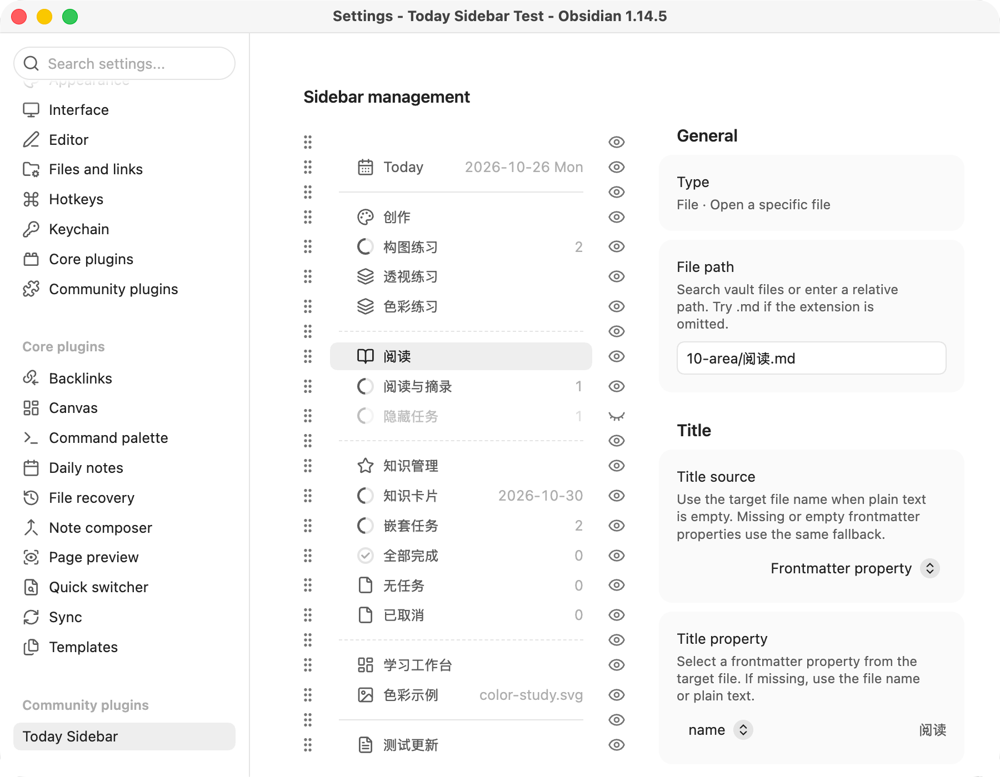

# Today Sidebar

Keep today's daily note and frequently used files together in Obsidian's left sidebar. Add file shortcuts, group them with separators, and display task counts or progress beside your notes.

[简体中文](README.zh-CN.md)

## Features

- Open today's existing daily note using a configurable folder and date format.
- Add shortcuts to files in your vault, including non-Markdown files. Reuse an open tab in the main editor when possible.
- Use custom text, file names, or frontmatter properties for titles and subtitles. Shorten long property titles without editing the note.
- Display a Markdown file's unfinished task count or show completed tasks as a progress ring; this works for file shortcuts and for today's daily note.
- Reorder items by dragging or using move buttons; hide items, add separators, and save reusable presets.
- Follow Obsidian's theme and interface language: Simplified Chinese for Chinese, English for other languages.

## Screenshots

[View the sidebar and settings in both languages and themes](docs/screenshots.md).

## Requirements and availability

Requires **Obsidian 1.8.7 or later**. Latest release: [**0.24.0**](https://github.com/Chartreuse310/obsidian-today-sidebar/releases/tag/0.24.0).

Desktop acceptance testing has passed on macOS with Obsidian 1.14.5. Mobile acceptance testing has also been completed without reported issues. No other community plugin is required.

## Manual installation

Download [ctz-today-sidebar.zip](https://github.com/Chartreuse310/obsidian-today-sidebar/releases/download/0.24.0/ctz-today-sidebar.zip) from the [0.24.0 release](https://github.com/Chartreuse310/obsidian-today-sidebar/releases/tag/0.24.0). The ZIP contains the runtime files and LICENSE. Community directory submission is the next step; use manual installation for now.

1. Unzip the download to get the `ctz-today-sidebar` folder.
2. Move that entire folder into your vault's plugin directory, normally `.obsidian/plugins/`. The result should include `.obsidian/plugins/ctz-today-sidebar/main.js`.
3. Open Obsidian's **Settings → Community plugins** and enable **Today Sidebar**. If it is not listed yet, restart Obsidian and check again.
4. Select the calendar tab in the left sidebar, or run **Today Sidebar: Show sidebar** from the command palette.

To update manually, replace the same three runtime files and LICENSE, then reload the plugin in Obsidian. Keep your existing plugin settings file.

## Getting started

Open **Settings → Today Sidebar** and select the **Today** item.

Set **Daily notes folder** and **Filename date format** to match where you keep your daily notes. The defaults resolve to `00-journal/YYYY-MM-DD.md`, using your device's local date. For example, on October 26, 2026, the target would be `00-journal/2026-10-26.md`. Leave the folder empty to use the vault root; omit `.md` from the date format. A preview shows the resolved path.

**Subtitle display** chooses between the date and today's unfinished task count. The date defaults to `YYYY-MM-DD ddd`, with weekday names in English; clearing the date format hides the subtitle without changing the path. Choosing the task count replaces the date with that number, keeps the date format saved, and restores the date when you switch back.

Today and regular file shortcuts open existing files. If today's note is missing, it shows the expected path so you can create it with your usual daily-note workflow.

### File shortcuts and layout

Choose **Add → File**, then select a vault file in **File path**. Choose how its title, subtitle, and icon should appear. Changes save as you edit.

Use the eye button to hide an item while keeping its settings. Drag the handle or use the move buttons to reorder items. Add a solid line, dashed line, or spacer to group shortcuts. Deleting an item removes its shortcut and keeps the file; Today can be hidden but cannot be deleted.

For repeated setups, use **Save as preset** on a file or separator. Add a copy from the Add menu; later edits to a preset and its copies are independent.

### New from template

Choose **Add → New from template**, select a Markdown **Template file**, and optionally set a **Default folder**, title, subtitle and icon. Template buttons also support presets.

Click the sidebar button to open the creation dialog: the folder input on the left suggests existing vault folders; the file name input on the right has a fixed, noneditable `.md` suffix outside the input. Change the default folder for each new note, or leave it empty / choose `/` for the vault root. Folders must already exist.

Click **Create** or press Enter to copy the template content and open the new note. Existing files are never overwritten. Content is copied as is, without evaluating template variables or Templater syntax. Errors keep the dialog and its inputs available for correction.

## Task counts and progress

For a file shortcut or today's daily note, set **Subtitle display → Unfinished tasks** or **Icon display → Progress ring**. Both options use only the target Markdown file, including nested tasks. Today's target is resolved from the date format, so the count and the ring follow the calendar and the current daily note.

Without Tasks settings, unchecked tasks count as unfinished and `x`/`X` tasks as completed. If the vault has Tasks status settings, Todo, In Progress, and On Hold count as unfinished; Done counts as completed. Cancelled, Non-Task, and unknown statuses are excluded. The progress ring shows completed / (unfinished + completed). Tasks query results and global filters are not applied.

A count of `0` means no unfinished tasks, `…` means metadata is pending, and `—` means statistics are unavailable. The progress ring falls back to the saved icon when there are no countable tasks or statistics are unavailable.

## Optional integrations

**Custom Icons:** Built-in Obsidian icons work on their own. With a compatible Custom Icons plugin enabled, click the icon preview beside **Button icon** to open its picker. If the provider is unavailable, incompatible, or cannot render the saved icon, a built-in icon is used. The saved icon ID is retained so the custom icon can return when available.

**Tasks:** When task counts or progress are in use, Today Sidebar reads the vault's Tasks status configuration if present; Tasks does not need to be running. It reads that configuration without changing it. Missing configuration uses standard checkbox states; unreadable or unsupported configuration makes statistics unavailable. The supported configuration format is based on Tasks 8.4.0.

## Data and settings

Today Sidebar saves its own settings in the vault's plugin configuration. It reads configured file metadata and task statuses for display, and opens files when you select a shortcut. It does not create daily notes or edit note contents. Removing a shortcut or preset does not delete its target file. Existing settings from earlier versions are preserved through migration.

### Privacy and integrations

Today Sidebar itself makes no network requests and includes no telemetry, ads, payment requirement, or account requirement. It uses vault file paths for suggestions and Obsidian's metadata cache for file properties and task counts. It saves its own settings through Obsidian and reads Tasks settings within the same vault when task statistics are enabled. It does not read files outside the vault during normal use.

Custom Icons is an optional, separately installed plugin. Opening its picker delegates to that plugin; its icon downloads and any network access are governed by that plugin. Today Sidebar obtains its API through a non-public Obsidian plugin lookup, checks contract version 1 and the required methods, and falls back to built-in icons if the integration is unavailable.

## License

Copyright (c) 2026 Chartreuse310.

Licensed under the [GNU General Public License, version 3 only](LICENSE) (`GPL-3.0-only`). This program comes without any warranty. Distributed modified versions must comply with GPLv3, including its source-code and license requirements. Third-party software retains its own licenses.

## More information

- [Change history](CHANGELOG.md)
- [Development guide](docs/development.md)
