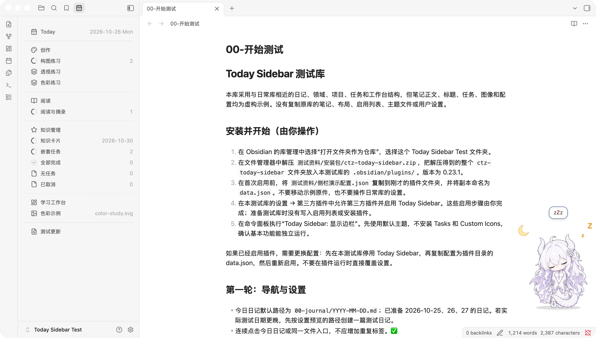
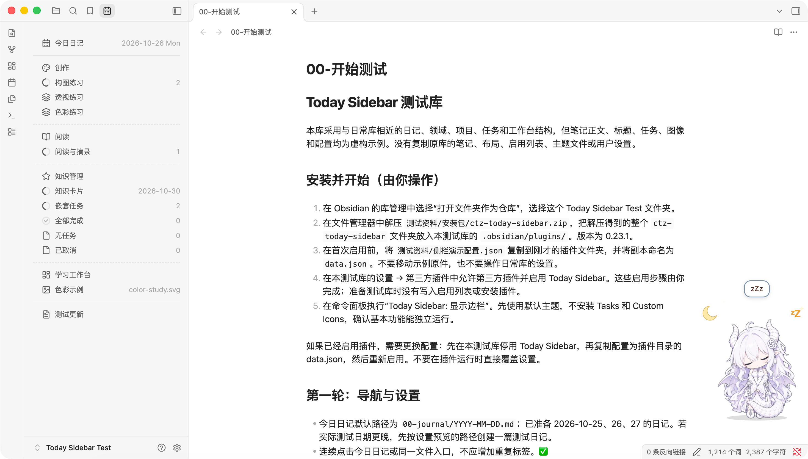
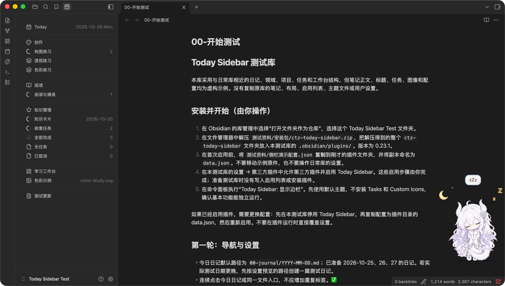
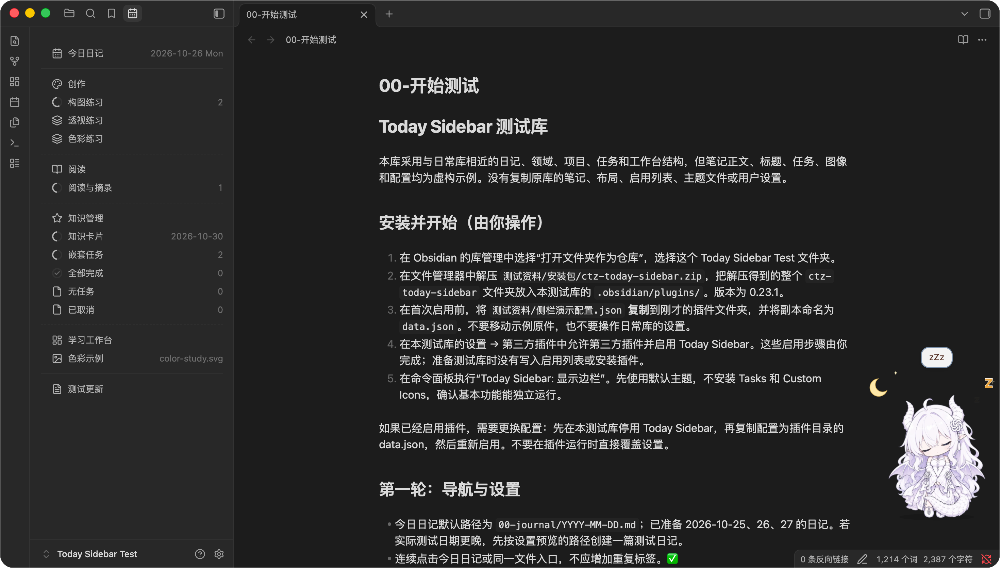
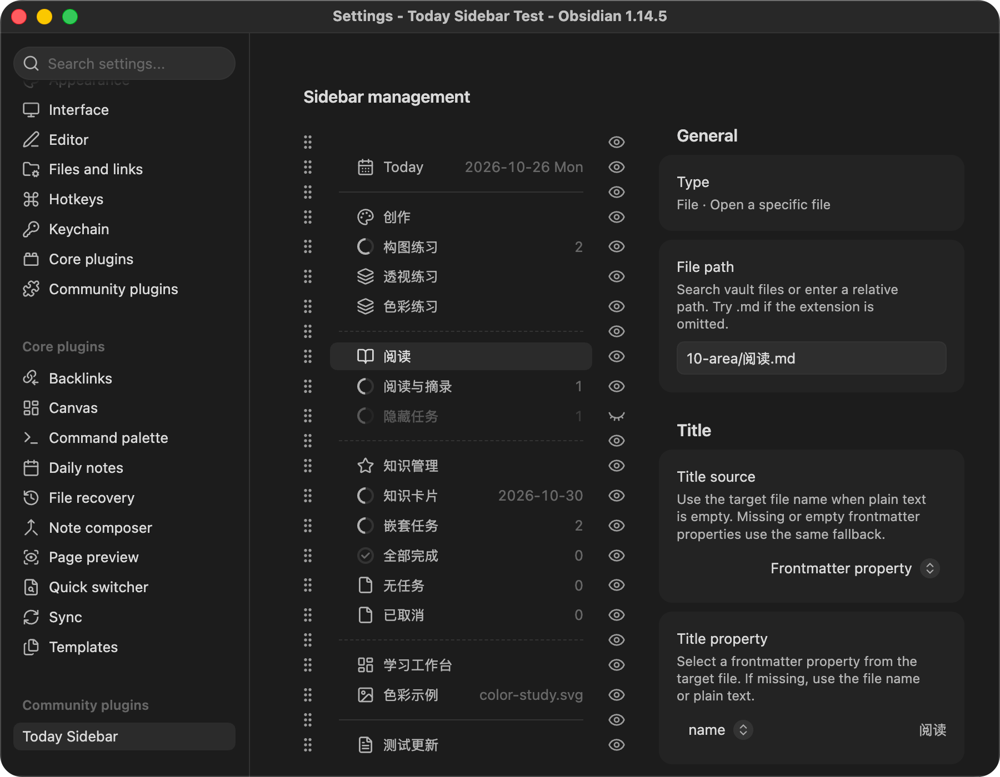
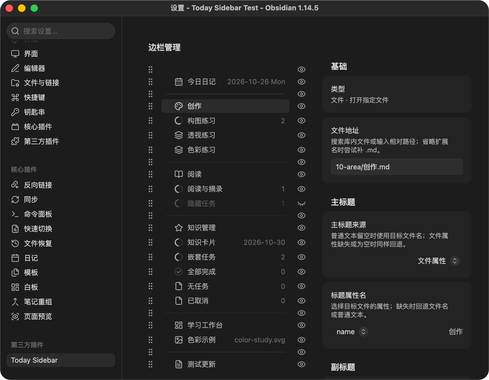

# Screenshots / 界面截图

[English overview](../README.md) · [中文说明](../README.zh-CN.md)

Captured from the synthetic Today Sidebar Test vault on macOS, Obsidian 1.14.5, using Today Sidebar 0.23.1. Note titles remain as saved when the interface language changes. These are desktop screenshots; mobile acceptance testing is pending.

以下截图来自示例测试库，不含私人笔记。界面语言切换不会改写已保存的条目标题；桌面验收已完成，移动端仍待验收。

## Sidebar / 侧栏

| Appearance / 外观 | English UI | 简体中文界面 |
| --- | --- | --- |
| Light / 浅色 |  |  |
| Dark / 深色 |  |  |

## Sidebar management / 边栏管理

| Appearance / 外观 | English UI | 简体中文界面 |
| --- | --- | --- |
| Light / 浅色 |  |  |
| Dark / 深色 |  |  |
